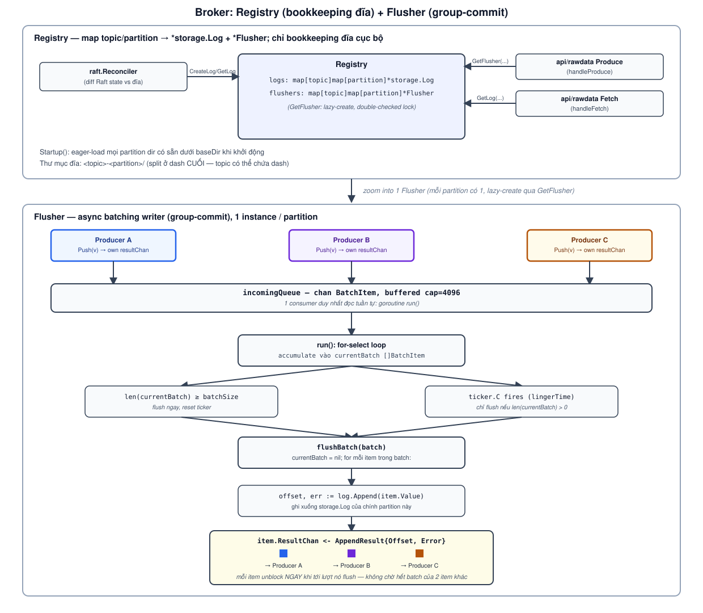

# Broker design: Registry + Flusher

This document describes `broker/registry.go` and `broker/flusher.go` — the thin layer sitting
between `storage` (the log engine) and the network servers in `api/` (see `CLAUDE.md`). As of Phase 2,
`broker` carries **no cluster metadata** at all — no topic config, no broker membership, no leader
election. All of that moved to the `raft` package. `broker` only answers one question: "what logs do
I have on my own disk, and how do I write to them."

## Why this shape

Two callers need very different things from the same on-disk partition:

- `api/rawdata`'s `Produce` path needs a **fast, batched** append — many concurrent producers writing
  to the same partition shouldn't each pay a separate `storage.Log.Append` call (and, eventually, a
  separate fsync).
- `api/rawdata`'s `Fetch` path and `raft.Reconciler` just need to **look up** or **create** the
  `*storage.Log` for a partition — no batching involved.

Splitting these into two types — `Registry` (lookup/creation bookkeeping) and `Flusher` (the batching
writer) — keeps `Registry` a simple concurrent map and keeps the group-commit logic isolated to the
one type that needs it, one `Flusher` per partition, created lazily only when something actually
produces to that partition.

## Registry: who calls it, and with what

`Registry` holds two maps, both `topic -> partition -> X`: `logs` (`*storage.Log`) and `flushers`
(`*Flusher`). Three callers reach into it, each for a different reason:

- **`raft.Reconciler`** calls `GetLog` to check "do I already have this partition on disk," then
  `CreateLog` for anything missing — this is what actually materializes a partition directory once
  Raft's `State.Topics[...].Partitions[...].Replicas` says this broker should own it.
- **`api/rawdata`'s `handleProduce`** calls `GetFlusher(topic, partition, batchSize, linger)` — lazily
  creates the partition's one `Flusher` on first use (double-checked locking: an `RLock`-guarded fast
  path, then a `Lock`-guarded slow path that re-checks before creating), `ok=false` if the log doesn't
  exist (raw Produce never auto-creates topics).
- **`api/rawdata`'s `handleFetch`** calls `GetLog` directly — `Fetch` reads straight off the
  `storage.Log`/`storage.Segment` zero-copy path (`docs/zero-copy-design.md`), no batching involved.

`Startup()` eager-loads every existing partition directory under `baseDir` on process start, so a
restarted broker picks up exactly the logs it had before — directory names are `<topic>-<partition>`,
split on the **last** `-` since topic names may themselves contain dashes. `CreateLog` creates the
partition directory (`os.MkdirAll`) and a fresh `storage.Log` in it, erroring if that exact
topic+partition pair already has one.

## Flusher: group-commit, one per partition

The bottom half of the same diagram traces one `Flusher`'s pipeline end to end:

1. Every `Push(value)` call gets back its own `chan AppendResult` (buffered 1) and enqueues a
   `BatchItem{Value, ResultChan}` onto `incomingQueue` (buffered 4096) — producers never block on each
   other here, only on the shared queue's capacity.
2. A single background goroutine (`run()`) is the **only** consumer of `incomingQueue`, so all batching
   decisions happen without locks — it accumulates incoming items into `currentBatch`.
3. A flush triggers one of two ways: `len(currentBatch) >= batchSize` (flush immediately, then reset
   the linger ticker), or the `lingerTime` ticker fires with a non-empty batch (classic group-commit:
   bound worst-case latency even under low throughput).
4. `flushBatch` calls `storage.Log.Append(item.Value)` for each item in the batch, **in order**, then
   immediately sends that item's own `AppendResult{Offset, Error}` down its own `ResultChan`.

The key property step 4 relies on: because each `BatchItem` carries its *own* channel rather than one
shared completion signal, producers that happened to land in the same batch unblock **independently**,
in the order their records were appended — not all at once when the whole batch finishes. `Close()`
closes `stopChan`, which makes `run()` flush whatever's left in `currentBatch` one last time before
returning (a graceful drain, not a hard stop mid-batch).

## Known trade-offs

- `flushBatch` has no `fsync`/`Sync` call yet (`flusher.go`'s own `// TODO: Sync for safety`) — a
  flush is "durable" only as far as the OS page cache, not a crash of the machine itself.
- `incomingQueue`'s buffer (4096) and `GetFlusher`'s `batchSize`/`linger` are caller-supplied today
  (`api/rawdata`'s `handleProduce` picks the constants) rather than coming from per-topic config —
  there's no per-topic override mechanism yet, matching `CLAUDE.md`'s note that `broker` carries no
  topic config at all anymore.
